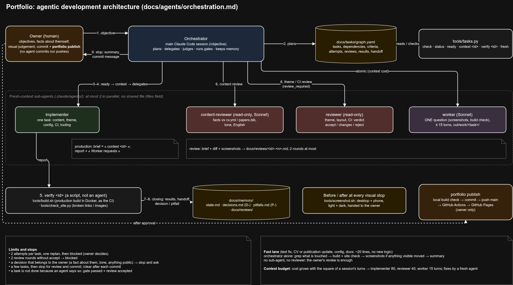

# Romain Andres — Portfolio

Personal academic/research portfolio, built with [Jekyll](https://jekyllrb.com/) on the [al-folio](https://github.com/alshedivat/al-folio) theme (MIT licensed). Live at **[vendenix.github.io/portfolio](https://vendenix.github.io/portfolio/)**.

## Stack

Jekyll (Ruby) + Liquid templates + SCSS. No Node/React involved — content lives in Markdown/YAML/BibTeX, not JS components. Local development runs entirely through Docker, no Ruby install required.

## Running locally

```bash
docker compose up
```

Then open **http://localhost:8080/portfolio/**. The first start installs the Ruby gems inside the container (~15–30s); subsequent starts are faster. The site auto-rebuilds on file changes (a few seconds), except `_config.yml`, which restarts the whole Jekyll process (~10–15s).

Stop with `Ctrl+C`, then:

```bash
docker compose down
```

If `docker-compose` (the standalone binary) errors out with a Python `distutils` traceback, use `docker compose` (the plugin, no hyphen) instead — that's what's used throughout this repo.

### Cleaning build artifacts

The container writes `_site/`, `.jekyll-cache/`, `.sass-cache/`, and `Gemfile.lock` as `root`, so a plain `rm -rf` from the host may fail with a permission error. If that happens:

```bash
docker run --rm -v "$(pwd)":/srv/jekyll -w /srv/jekyll amirpourmand/al-folio:latest \
  rm -rf _site .jekyll-cache .sass-cache Gemfile.lock
```

(All of these are gitignored — this is only about keeping the working directory tidy.)

## Adding / editing content

| What | Where | Notes |
|---|---|---|
| New project write-up | `_posts/YYYY-MM-DD-slug.md` | One file per project. Copy an existing post as a template (front matter: `title`, `description`, `date`, `tags`, `categories`, `thumbnail`). Images go in `assets/img/projects/<slug>/`. |
| Bio / home page | `_pages/about.md` | Front matter controls the profile photo/subtitle; body is free Markdown. |
| CV | `_data/cv.yml` | Structured Education/Experience/Skills blocks — no HTML to touch. |
| CV PDF download | `assets/pdf/` | Replace the file, then update `cv_pdf:` in `_pages/cv.md` if the filename changes. |
| Publications | `_bibliography/papers.bib` | Standard BibTeX; extra fields like `preview`, `abbr`, `selected` are al-folio-specific. |
| Nav pages (cv/publications/projects) | `_pages/*.md` | Front matter only (`title`, `nav_order`, `description`) — avoid touching the Liquid body unless you mean to. |

## Deployment

Every push to `main` rebuilds and deploys the site (`.github/workflows/main.yml`, GitHub Actions → Pages, ≈ 2–3 min). The `portfolio` command wraps the whole routine (install it once with `tools/portfolio install`, which links it into `~/.local/bin`):

```bash
portfolio dev                     # local site with live reload, http://localhost:8080/portfolio/
portfolio build                   # production build as the CI + broken links/images check
portfolio publish "Update CV"     # build check, commit everything, push to main, follow the deployment
portfolio status                  # last deployments and whether the site answers
```

`publish` asks for confirmation (`-y` to skip it, `--fast` to skip the local build). Run from a branch, it pushes the branch, merges it into `main` and pushes `main`.

## Working with agents (Claude Code)

The repository carries its own agent system: common rules in `AGENTS.md` (loaded through
`CLAUDE.md`), roles in `.claude/agents/`, the `/objective` command to plan and run a goal end to
end, project memory in `docs/memory/` (start with `state.md`), tasks in `docs/tasks/graph.yaml`,
reviews in `docs/reviews/`. How it fits together: `docs/agents/orchestration.md`. Agents never
commit nor push: a push to `main` publishes the site.

The point is not to let an AI write the site unchecked, but to make its work verifiable:

- a task is not finished because an agent says so;
- every task passes an automatic gate (production build, broken links and images);
- a distinct reviewer actively looks for why the work is wrong;
- the memory of past mistakes is dated and sourced (`docs/memory/pitfalls.md`).



```bash
tools/build.sh                                  # production build, as the CI -> out/site/
python3 tools/check_site.py                     # broken internal links / images
tools/screenshot.sh out/shots "" cv/            # desktop + phone, light + dark
python3 tools/tasks.py status                   # task graph
```

`docs/`, `tools/`, `out/`, `AGENTS.md` and `CLAUDE.md` are excluded from the site in `_config.yml`.

## License

The theme (layouts, includes, SCSS, plugins) is [al-folio](https://github.com/alshedivat/al-folio), MIT licensed — see `LICENSE`. All content (bio, CV, projects, publications) is Romain Andres's own.
